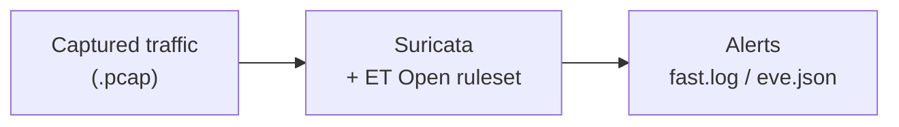
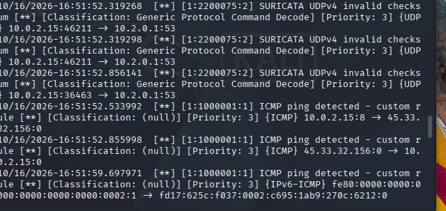

# Suricata IDS: Traffic Analysis Lab

I used **Suricata**, an open-source intrusion detection system (IDS), to analyze captured network traffic and detect suspicious activity, including a custom detection rule I wrote and tested myself.

**Tools:** Suricata, Kali Linux, tcpdump, Nmap

> All analysis was done offline against captured traffic in a virtual machine. Nothing was run live against any real system.

## What is an IDS?

An **Intrusion Detection System** inspects network traffic and raises an alert when it matches a known attack pattern, like a port scan or malicious request. Reading and triaging these alerts is a core part of a SOC analyst's job. Suricata is a widely used IDS that works on both live traffic and recorded captures (`.pcap` files).

## How it works



1. Suricata is loaded with the **ET Open ruleset** (thousands of community detection rules).
2. It reads a **captured traffic file** packet by packet.
3. Any traffic matching a rule generates an **alert**.
4. I reviewed the alerts and then wrote **my own rule** to confirm I understood how detection works.

## Analyzing the capture

I captured my own traffic (a ping and an Nmap scan against `scanme.nmap.org`, Nmap's official legal scan target) with tcpdump, then ran Suricata against it:

```
sudo suricata -r mycapture.pcap -s /etc/suricata/rules/local.rules -l ./logs
cat ./logs/fast.log
```

## My custom detection rule

I added a rule to `/etc/suricata/rules/local.rules` to alert on any ICMP ping:

```
alert icmp any any -> any any (msg:"ICMP ping detected - custom rule"; sid:1000001; rev:1;)
```

Suricata fired on the traffic, including **my custom rule** catching the ping to `scanme.nmap.org`:



**What the alerts show:**
- **My custom rule (`ICMP ping detected - custom rule`)** caught the ping between my VM (`10.0.2.15`) and `scanme.nmap.org` (`45.33.32.156`), proof the rule I wrote detects real traffic.
- **Suricata's built-in engine** also flagged `UDPv4 invalid checksum` on the DNS traffic. This is a known **capture artifact** (checksums are filled in by hardware after capture, so they look "invalid" in a pcap), not a real attack, the kind of noise a SOC analyst learns to recognize and rule out.

**Rule breakdown:**
- `alert icmp`: raise an alert for ICMP (ping) traffic
- `any any -> any any`: any source/port to any destination/port
- `msg:`: the text shown in the alert
- `sid:`: unique rule ID (1000000+ is reserved for custom rules)

## What I learned

- How signature-based intrusion detection works
- How to install Suricata and apply a community ruleset
- How to read IDS alerts in `fast.log` and `eve.json`, the heart of SOC work
- How to write and test a custom detection rule
- The difference between analyzing captured traffic and monitoring live

## Next steps

- Forward alerts into a SIEM (Splunk or Wazuh) to practice full alert triage
- Add rules for more attack types (brute-force, suspicious user agents)
- Tune rules to cut down false positives

*Built as a self-study project to practice SOC and detection skills.*
