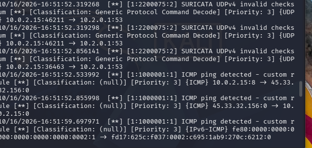

# Suricata IDS Lab

I captured some of my own traffic on Kali Linux, ran it through Suricata offline, and wrote a simple custom rule to see how detection rules work.

**Tools:** Suricata (ET Open ruleset), tcpdump, Nmap, Kali Linux in a VM

## What I did

1. Captured a ping and an Nmap scan against `scanme.nmap.org` (Nmap's official test target) with tcpdump.
2. Added a custom rule to `/etc/suricata/rules/local.rules`:

   ```
   alert icmp any any -> any any (msg:"ICMP ping detected - custom rule"; sid:1000001; rev:1;)
   ```

   It alerts on any ICMP traffic. `sid` values of 1000000 and up are meant for local rules.

3. Ran Suricata against the capture and read the alerts:

   ```
   sudo suricata -r mycapture.pcap -s /etc/suricata/rules/local.rules -l ./logs
   cat ./logs/fast.log
   ```

## Results



- My rule fired on the ping from my VM (`10.0.2.15`) to `scanme.nmap.org` (`45.33.32.156`).
- Suricata also flagged `UDPv4 invalid checksum` on DNS traffic. That isn't an attack. The checksums get filled in by the network card after tcpdump grabs the packet, so they look wrong in the capture. It's a false positive caused by how the traffic was captured.

## Next

- Send the alerts to a SIEM (Wazuh or Splunk) instead of reading `fast.log`.
- Write rules for something more realistic than ping, like SSH brute-forcing.
